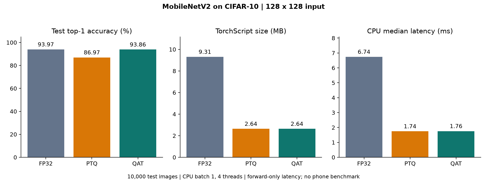

# MobileNetV2 INT8 quantization

Compare FP32, post-training quantization (PTQ), and quantization-aware training
(QAT) on CIFAR-10 using PyTorch's quantizable MobileNetV2. QAT retained **93.86%
test top-1 accuracy**, within **0.11 percentage points** of FP32, with a **3.53×
smaller TorchScript artifact** and **3.84× lower median CPU forward latency**.

## Measured results

| Model | Test top-1 | Artifact bytes | CPU p50 (ms) | CPU p95 (ms) |
| --- | ---: | ---: | ---: | ---: |
| FP32 | 93.97% | 9,309,232 | 6.741 | 8.059 |
| INT8 PTQ | 86.97% | 2,637,118 | 1.744 | 2.381 |
| INT8 QAT | 93.86% | 2,635,564 | 1.756 | 3.050 |



[Full results](reports/runs/baseline_20261020_205732_882136/final_20261020_214520_852879/summary.json) · [Environment](reports/runs/baseline_20261020_205732_882136/final_20261020_214520_852879/environment.json) ·
[600 latency samples per model](reports/runs/baseline_20261020_205732_882136/final_20261020_214520_852879/latency_samples.csv)

## Method

- ImageNet-initialized MobileNetV2; CIFAR-10 images resized to 128×128.
- Separate 44,000 training, 5,000 validation and 1,000 calibration images;
  10,000 held-out test images evaluated after model selection.
- INT8 weights and activations with the x86 backend. Observer audit distinguishes
  inactive residual observers from unexpected uncalibrated observers.
- RTX 3070 Laptop GPU for training; Ryzen 9 5900HS for inference.
- Batch-one TorchScript forward calls, four CPU threads, six balanced model-order
  blocks, 50 warmups per block and 600 measured calls per model.

Latency excludes preprocessing, file loading and device transfers. These are
single-machine measurements, not phone benchmarks or end-to-end application
latency. Artifact size excludes the runtime. Training and test accuracy reflect
one seeded experiment, not variation across multiple training seeds.

## Reproduce on Windows

Use Python 3.11 and a CUDA-capable GPU for training. Recorded environment:
Python 3.11.9, torch 2.7.1+cu126, torchvision 0.22.1+cu126.

```powershell
python -m venv .venv
.\.venv\Scripts\python.exe -m pip install torch==2.7.1 torchvision==0.22.1 --index-url https://download.pytorch.org/whl/cu126
.\.venv\Scripts\python.exe -m pip install -r requirements.txt
.\.venv\Scripts\python.exe train_baseline.py
```

Set `$baseline` to the new run path printed by training; use each subsequent
printed output path in the next stage:

```powershell
$baseline = "runs\baseline_YOUR_RUN"
.\.venv\Scripts\python.exe run_ptq.py --baseline $baseline
.\.venv\Scripts\python.exe audit_ptq.py --baseline $baseline
$ptq = "$baseline\ptq_YOUR_RUN"
.\.venv\Scripts\python.exe run_qat.py --baseline $baseline --ptq $ptq
$qat = "$baseline\qat_YOUR_RUN"
.\.venv\Scripts\python.exe finalize_quantization.py --baseline $baseline --ptq $ptq --qat $qat
```

The scripts download CIFAR-10 and pretrained torchvision weights. Checkpoints
are generated locally and excluded from Git. The published reports are not
checkpoints. `--smoke-test` on training/QAT is for execution checks, not reported
performance. Model and dataset use remain subject to their upstream terms.

## Code map

| File | Purpose |
| --- | --- |
| `train_baseline.py` | Seeded splits, transfer learning, validation selection |
| `run_ptq.py` | Calibration and INT8 conversion |
| `audit_ptq.py` | Observer coverage audit |
| `run_qat.py` | Fake-quantization fine-tuning and checkpoint selection |
| `finalize_quantization.py` | Held-out accuracy, balanced latency benchmark, plots |
